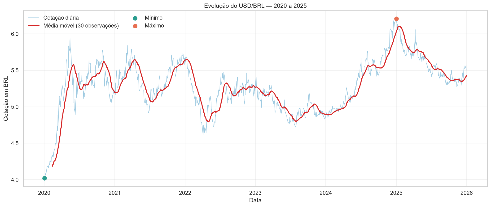
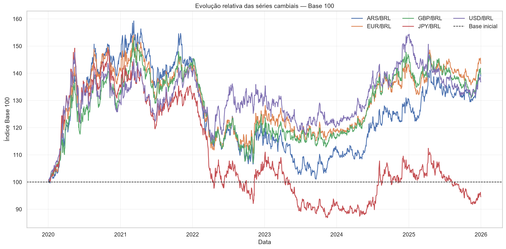
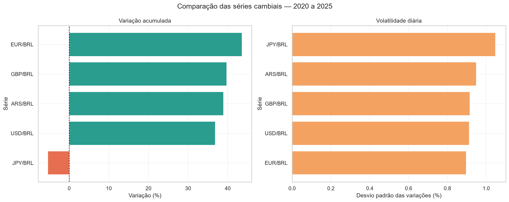
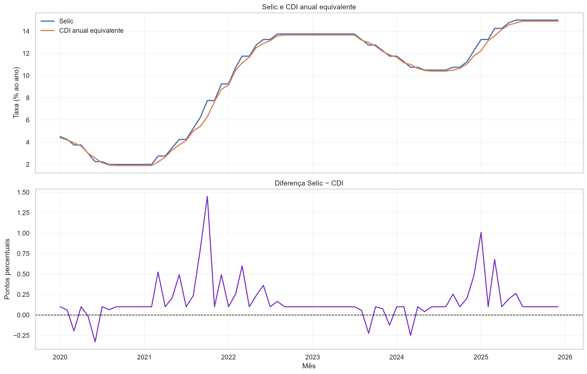
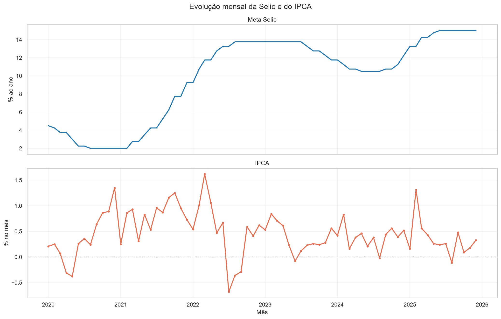
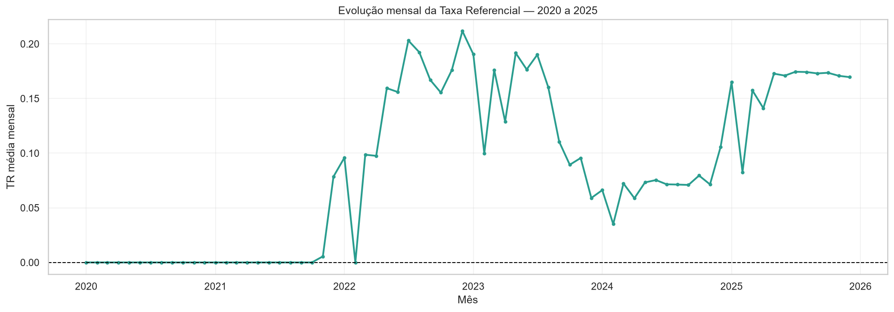
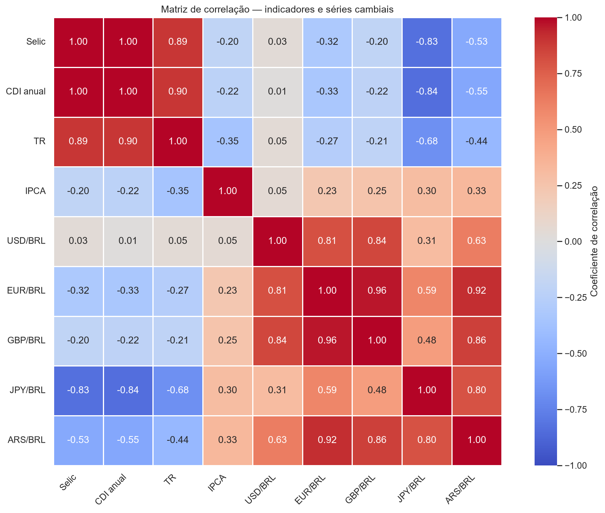

# Projeto Hands-on BACEN

## Análise exploratória de câmbio e indicadores econômicos

Este projeto implementa um pipeline de dados e uma análise exploratória de séries públicas do Banco Central do Brasil. A solução combina a arquitetura originalmente desenvolvida no Databricks com uma etapa local de análise em Python, executada no Visual Studio Code e versionada no GitHub.

A versão final do EDA utiliza os arquivos processados produzidos durante o desenvolvimento e apresenta uma visão consolidada do período entre **2020 e 2025**.

> **Importante:** as análises são descritivas. Correlações não representam causalidade, e os resultados não constituem previsão ou recomendação financeira.

---

## Navegação

- [Visão geral](#visão-geral)
- [Arquitetura](#arquitetura)
- [Séries analisadas](#séries-analisadas)
- [Estrutura do repositório](#estrutura-do-repositório)
- [Como executar](#como-executar)
- [Qualidade e metodologia](#qualidade-e-metodologia)
- [Resultados do EDA](#resultados-do-eda)
- [Base mensal consolidada](#base-mensal-consolidada)
- [Limitações](#limitações)
- [Próximos passos](#próximos-passos)
- [Links úteis](#links-úteis)

---

## Visão geral

O projeto reúne cinco séries cambiais e quatro indicadores econômicos. Os dados foram inicialmente organizados em uma arquitetura de camadas no Databricks e posteriormente analisados localmente com Python.

O fluxo analítico é representado por:

```text
API SGS do BACEN
        ↓
Ingestão e armazenamento bruto
        ↓
Camadas Bronze e Silver no Databricks
        ↓
Arquivos processados em CSV
        ↓
EDA em Python e Jupyter Notebook
        ↓
Gráficos, resumos e base mensal consolidada
        ↓
Consumo futuro no Power BI e na camada Gold
```

### Objetivos

- avaliar a qualidade e a cobertura das séries;
- explorar o comportamento histórico do câmbio;
- comparar as moedas em uma escala comum;
- analisar Selic, CDI, TR e IPCA;
- estudar associações lineares entre as variáveis;
- preparar uma base mensal para consumo analítico;
- apoiar a futura construção da camada Gold e de dashboards.

---

## Arquitetura

A solução segue o princípio de separação entre dados brutos e dados tratados. A camada Bronze preserva os dados próximos à origem, enquanto a camada Silver padroniza datas, valores e identificadores. A camada Gold permanece como evolução orientada pelas necessidades de consumo.

```text
BACEN SGS API
     ↓
Python / Requests
     ↓
Unity Catalog Volume / NDJSON
     ↓
Auto Loader
     ↓
Bronze
     ↓
Silver
     ↓
EDA local e base analítica mensal
     ↓
Gold e Power BI — evolução planejada
```

---

## Séries analisadas

### Câmbio

| Série | Código SGS | Granularidade de origem |
|---|---:|---|
| USD/BRL | 1 | Diária |
| EUR/BRL | 21619 | Diária |
| GBP/BRL | 21623 | Diária |
| JPY/BRL | 21621 | Diária |
| ARS/BRL | 21632 | Diária |

### Indicadores econômicos

| Série | Código SGS | Tratamento utilizado no EDA |
|---|---:|---|
| Selic meta | 432 | Último valor disponível no mês |
| CDI diário | 12 | Conversão para taxa anual equivalente e média mensal |
| Taxa Referencial | 226 | Média mensal |
| IPCA | 433 | Observação mensal |

---

## Estrutura do repositório

```text
projeto_hands_on/
├── databricks/
│   ├── notebooks/
│   ├── transformations/
│   └── README.md
├── data/
│   ├── raw/
│   └── processed/
│       ├── base_economica_mensal_2020_2025.csv
│       ├── cambio_2020_2025.csv
│       ├── cambio_base_100_2020_2025.csv
│       ├── cambio_mensal_2020_2025.csv
│       └── arquivos de resumo e qualidade
├── eda/
│   ├── eda_bacen.ipynb
│   └── eda_bacen_final.ipynb
├── images/
│   └── eda_final/
│       ├── 01_evolucao_usd_brl.png
│       ├── 02_cambio_base_100.png
│       ├── 03_variacao_volatilidade_cambio.png
│       ├── 04_selic_cdi.png
│       ├── 05_selic_ipca.png
│       ├── 06_tr_mensal.png
│       └── 07_matriz_correlacao.png
└── README.md
```

### Notebooks

- `eda/eda_bacen.ipynb`: histórico completo do desenvolvimento, incluindo testes e etapas intermediárias;
- `eda/eda_bacen_final.ipynb`: versão consolidada, mais curta e adequada para execução, apresentação e renderização no GitHub.

---

## Como executar

### 1. Clonar o repositório

```bash
git clone https://github.com/talusousa/projeto_hands_on.git
cd projeto_hands_on
```

### 2. Criar o ambiente virtual

```bash
python -m venv .venv
```

### 3. Ativar no Windows

No Prompt de Comando:

```cmd
.venv\Scripts\activate.bat
```

### 4. Instalar as dependências

```bash
python -m pip install pandas numpy matplotlib seaborn jupyter ipykernel
```

### 5. Executar o notebook final

Abra:

```text
eda/eda_bacen_final.ipynb
```

Selecione o kernel da `.venv` e execute **Run All**.

O notebook utiliza os CSVs em `data/processed` e exporta automaticamente as figuras para:

```text
images/eda_final/
```

---

## Qualidade e metodologia

O EDA avalia:

- cobertura temporal;
- tipos de dados;
- valores nulos;
- linhas e datas duplicadas;
- valores inválidos;
- granularidade das séries;
- consistência da base mensal consolidada.

### Decisões metodológicas

- as moedas são comparadas pelo índice Base 100 porque possuem escalas diferentes;
- a volatilidade cambial é representada pelo desvio padrão das variações percentuais entre observações consecutivas;
- o CDI diário é convertido em taxa anual equivalente considerando 252 dias úteis;
- a diferença Selic menos CDI é expressa em pontos percentuais;
- Selic e IPCA permanecem em unidades diferentes e são apresentados em painéis separados;
- valores iguais a zero na TR não são classificados automaticamente como erro;
- a correlação de Pearson é utilizada apenas como ferramenta exploratória.

---

# Resultados do EDA

## 1. Evolução do USD/BRL

A visualização apresenta a série diária do USD/BRL, sua média móvel de 30 observações e os valores extremos encontrados no período. A média móvel reduz o ruído diário e facilita a observação de movimentos mais persistentes.



---

## 2. Comparação cambial por índice Base 100

As moedas possuem valores absolutos e bases de cotação diferentes. O índice Base 100 transforma a primeira observação de cada série em 100 e permite comparar somente a evolução relativa durante o período.



---

## 3. Variação acumulada e volatilidade cambial

A variação acumulada compara a primeira e a última observação disponível. A volatilidade representa a dispersão das variações percentuais entre observações consecutivas. As duas medidas descrevem aspectos diferentes e devem ser interpretadas em conjunto.



---

## 4. Selic e CDI anual equivalente

A série original do CDI possui taxa diária, enquanto a meta Selic é expressa ao ano. O CDI foi convertido para taxa anual equivalente antes da comparação. O painel inferior apresenta a diferença entre as taxas em pontos percentuais.



---

## 5. Selic e IPCA

A Selic é uma taxa anual e o IPCA representa uma variação mensal. Por isso, as séries são mantidas em unidades próprias e apresentadas em painéis separados. A análise permite comparar trajetórias sem tratar os indicadores como medidas diretamente equivalentes.



---

## 6. Evolução mensal da Taxa Referencial

A TR é apresentada por meio da média dos valores disponíveis em cada mês. Valores iguais a zero podem ser observações válidas e não são removidos automaticamente.



---

## 7. Matriz geral de correlação

A matriz apresenta associações lineares contemporâneas entre as médias mensais das moedas e os indicadores econômicos. Coeficientes elevados podem resultar de tendências compartilhadas ou de fatores externos não incluídos na análise.



> **Atenção:** correlação não demonstra causalidade.

---

## Base mensal consolidada

A principal saída técnica do EDA é:

```text
data/processed/base_economica_mensal_2020_2025.csv
```

A base possui uma linha por mês e reúne:

- mês de referência;
- Selic;
- CDI anual equivalente;
- TR média mensal;
- IPCA mensal;
- média mensal de USD/BRL;
- média mensal de EUR/BRL;
- média mensal de GBP/BRL;
- média mensal de JPY/BRL;
- média mensal de ARS/BRL.

Essa estrutura pode apoiar:

- camada Gold;
- modelo semântico no Power BI;
- dashboards econômicos;
- análises de correlação;
- estudos futuros de séries temporais.

---

## Limitações

- período restrito a 2020–2025;
- uso exclusivo das séries definidas no escopo do projeto;
- ausência de acesso ao ambiente Databricks original durante o desenvolvimento local do EDA;
- regras mensais definidas para fins exploratórios;
- ausência de variáveis externas e expectativas de mercado;
- redução das oscilações diárias quando os dados são agregados mensalmente;
- análise de correlação limitada a associações lineares;
- ausência de testes econométricos;
- ausência de finalidade preditiva;
- resultados não constituem recomendação financeira.

---

## Próximos passos

- [ ] Validar as regras mensais com o responsável funcional;
- [ ] Implementar testes automatizados de qualidade;
- [ ] Construir a camada Gold no Databricks;
- [ ] Criar modelo estrela para consumo no Power BI;
- [ ] Desenvolver dashboard interativo;
- [ ] Automatizar a atualização periódica das séries;
- [ ] Criar catálogo de dados com unidade, frequência e regra de agregação;
- [ ] Avaliar estacionariedade e transformações temporais;
- [ ] Testar modelos preditivos somente após validação metodológica.

---

## Links úteis

| Plataforma | Finalidade | Acesso |
|---|---|---|
| GitHub | Código, notebooks e resultados processados | [Abrir repositório](https://github.com/talusousa/projeto_hands_on) |
| Projeto original | Repositório utilizado como origem do fork | [Abrir projeto original](https://github.com/juliocesar2003-data/projeto_hands_on) |
| Draw.io | Diagrama da arquitetura | [Abrir diagrama](https://drive.google.com/file/d/1DdaH-_L-o5VK6mrAtpWC25VreFqdXnSL/view?usp=drivesdk) |
| Trello | Gestão das atividades do projeto | [Abrir quadro](https://trello.com/invite/b/6acd81c0dfdb54a364cb0eaa/ATTI171ad2d451f2f37a94aed85cdd78c3c3E9A659BD/my-trello-board) |

---

## Tecnologias

- Python;
- Pandas;
- NumPy;
- Matplotlib;
- Seaborn;
- Jupyter Notebook;
- Visual Studio Code;
- Git e GitHub;
- Databricks;
- Unity Catalog;
- Auto Loader;
- Spark Declarative Pipelines;
- Power BI como evolução de consumo.

---

## Observação final

O notebook final foi propositalmente estruturado para utilizar os arquivos processados em vez de repetir toda a coleta e transformação da API. Essa separação mantém o relatório menor, facilita sua renderização no GitHub e preserva o notebook original como evidência do desenvolvimento completo.
